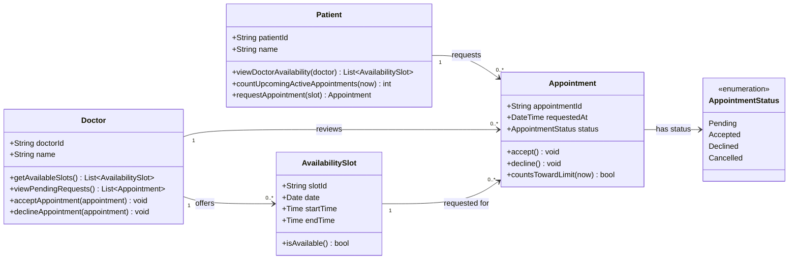

# Class Diagram — Doctor Appointment Booking System

This class diagram is based on `requirements.txt` (R1–R7, N = 5) and the merged `use_cases.md` (UC1–UC3). It deliberately keeps the domain model small for the assignment.

## Mermaid Class Diagram

## Class Responsibilities

| Class | Responsibility |
| --- | --- |
| **Patient** | Views a doctor's available slots and requests an appointment only when the upcoming active-appointment limit permits it. |
| **Doctor** | Offers availability slots and accepts or declines pending appointment requests. |
| **AvailabilitySlot** | Represents one doctor's date and time interval; determines whether the interval can be requested. |
| **Appointment** | Represents the request connecting a patient, doctor and availability slot; tracks status and status transitions. |
| **AppointmentStatus** | Restricts statuses to `Pending`, `Accepted`, `Declined`, and `Cancelled`. |

## Rules and Constraints

1. **N = 5 (R4):** Before creating an appointment, `Patient.requestAppointment(slot)` must reject the request if the patient already has **5 or more future appointments** with status `Pending` or `Accepted`. Past, `Declined`, and `Cancelled` appointments do not count.
2. **Available slot (R1–R2):** The patient can inspect available dates/times through the doctor. A request must target an available slot. On successful request, a new appointment starts as `Pending`.
3. **Doctor decision (R3):** Only the doctor responsible for the appointment decides whether a pending request becomes `Accepted` or `Declined`.
4. **Design assumption — prevent conflicting active bookings:** A slot is treated as unavailable while it already has a `Pending` or `Accepted` appointment. A declined/cancelled request can remain in history without permanently blocking the slot. That is why an availability slot is linked to `0..*` historical appointments; only **one** may be active for the slot at a time.
5. **Time intervals:** An `AvailabilitySlot` belongs to exactly one doctor; an appointment concerns exactly one slot and is requested by exactly one patient. The appointment's doctor is determined by its slot and also shown directly for clarity in the review flow.

## Requirements and Use-Case Traceability

| Source | Design support |
| --- | --- |
| R1 / UC1 | `Doctor`, `AvailabilitySlot`, `Patient.viewDoctorAvailability()` |
| R2 / UC2 | `Patient.requestAppointment()`, `Appointment`, `AvailabilitySlot.isAvailable()` |
| R3 / UC3 | `Doctor.acceptAppointment()`, `Doctor.declineAppointment()`, `Appointment.status` |
| R4 / UC2 | `Patient.countUpcomingActiveAppointments()`, `Appointment.countsTowardLimit()` and **N = 5** rule |

## Non-Functional Requirements (Design Notes Only)

The assignment says R5–R7 need to be **explained**, not necessarily implemented or tested:

- **R5 — Authorized access to medical data:** A future implementation should check authorization before exposing patient medical data. No medical-record class is added because medical-record functionality is not in R1–R4.
- **R6 — Availability shown within two seconds:** The implementation should make available-slot queries efficient and measure response time when required.
- **R7 — Mobile usability:** If the team builds a web interface, its layout should be responsive on mobile screens. A console application is also permitted by the assignment.

This model is intentionally limited to the requirements and approved use cases; it does not introduce payments, notifications, account approval, or medical-record management.
