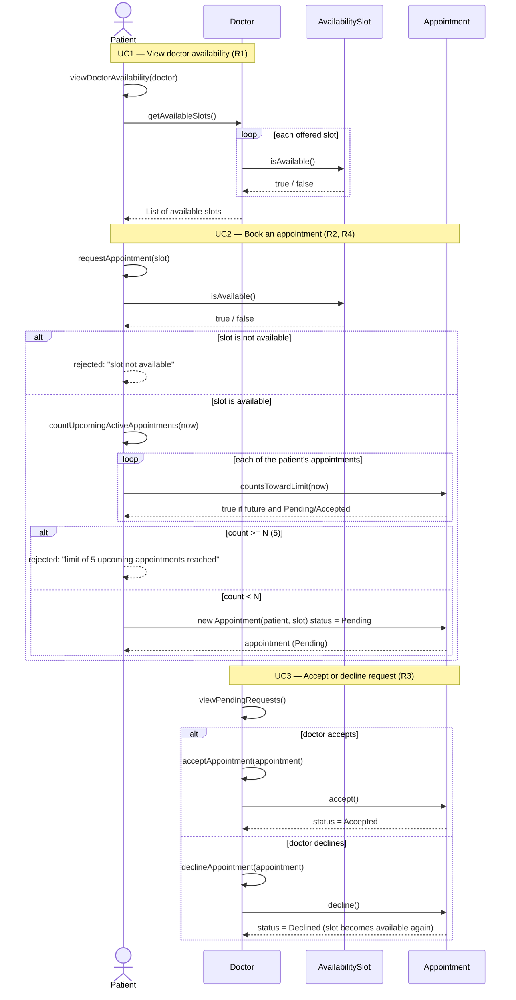

# Sequence Diagram — Book an Appointment

Built from `class_diagram.md` (Stage 2) and `use_cases.md` UC1–UC3. Every message below is a method that exists in the class diagram. N = 5.

## Mermaid Sequence Diagram

## What we checked against the class diagram

| Message in the sequence | Class diagram method |
| --- | --- |
| `viewDoctorAvailability(doctor)` | `Patient.viewDoctorAvailability(doctor)` |
| `getAvailableSlots()` | `Doctor.getAvailableSlots()` |
| `isAvailable()` | `AvailabilitySlot.isAvailable()` |
| `requestAppointment(slot)` | `Patient.requestAppointment(slot)` |
| `countUpcomingActiveAppointments(now)` | `Patient.countUpcomingActiveAppointments(now)` |
| `countsTowardLimit(now)` | `Appointment.countsTowardLimit(now)` |
| `viewPendingRequests()` | `Doctor.viewPendingRequests()` |
| `acceptAppointment` / `declineAppointment` | `Doctor.acceptAppointment(appointment)` / `Doctor.declineAppointment(appointment)` |
| `accept()` / `decline()` | `Appointment.accept()` / `Appointment.decline()` |

- The slot is checked **before** the N limit, and the limit is checked **before** the appointment is created (order matters).
- Both rejection branches (`slot not available`, `limit reached`) are shown with `alt / else`, plus the accept / decline branch for the doctor.
- Answers are dashed arrows (`-->>`) going back to the caller.
