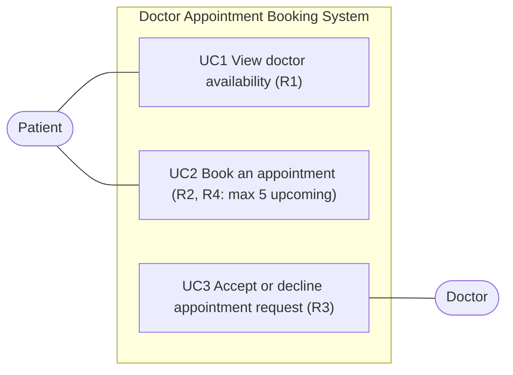

# Use Case Diagram — Doctor Appointment Booking System

Drawn from `use_cases.md` (UC1–UC3). Actors are Patient and Doctor. N = 5.

- Actors stand outside the system box; use cases are inside it.
- R5–R7 are non-functional, so they are not use cases (see README).
